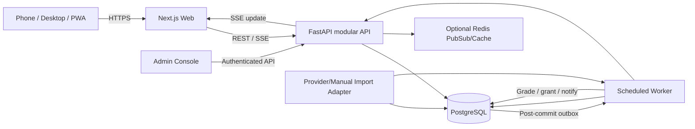

# 07 · Technical architecture

## Recommended shape: modular monolith + worker

Three users do not need microservices or Kafka. Separate *business modules* while sharing an API deployment and PostgreSQL transactions. We already have a path to add external data sources, statistical modeling, webhooks, and season replays without refactoring wallet correctness.



## Modular boundaries

- `auth`: invite-only sessions, roles, identity and security controls.
- `league`: seasons, players, grants, leaderboard, achievements.
- `events`: tournaments, series, games, participants, schedules, states.
- `markets`: typed definitions, scope, outcomes, pricing snapshots, lock, visibility.
- `tickets`: quotes, accepted picks, stake authorization, immutable snapshots.
- `ledger`: transactional signed wallet journal and reconciliations; optional double-entry migration later.
- `results`: canonical data, provider observations, verification/quality decisions.
- `settlement`: deterministic graders and idempotent payout/reversal.
- `odds`: pricing strategy adapter (`manual`, `elo`, `simulation`) and offline calibration.
- `notifications`: SSE, user alerts, after-lock social feed.
- `admin`: audited management actions, queue, feature flags.

## Runtime responsibilities

**Client:** presentation and local unsubmitted slip only. No authoritative balance/market lock calculation. UI may estimate slip totals for feedback but uses server quote on acceptance. **API:** transactions and validation; emits durable outbox events. **Worker:** scheduled grants, fixture sync, market auto-lock, odds-refresh jobs, result ingest, settle jobs, outbox publisher, retry and reconciliation. **Postgres:** system of record for accepted odds, results evidence, ledger, audit trail. **Redis:** optional ephemeral performance path; correctness cannot depend on it.

Use a single DB + Postgres-backed job/outbox first (`FOR UPDATE SKIP LOCKED`). Add Redis as an optimization, not a required component. For three users, SSE is plenty; one reconnecting stream/event source is simpler than websocket multiplexer.

## Event and transaction design

Every accepted ticket gets a `client_idempotency_key` scoped to `(user, season)`, stored and unique. In one serializable or row-lock protected transaction: query live market and cutoff in DB using authoritative server time; lock wallet account; ensure balance; write selections and frozen accepted odds; insert debit ledger entries; update cached wallet balance; commit; publish `TicketAccepted` via transactional outbox. Network replay returns *the same ticket*, not another debit.

Settlement locks each selection and wallet, checks existing unique settlement key `(selection_id, result_revision)`, writes WIN/LOSS/VOID result, appropriate credits, and audit/provenance; creates outbox event. Correcting a result creates new revision, reversing old *credits*, adding new payout. Use deterministic lock order to avoid deadlocks. Reconcile cached balance to ledger nightly.

## Streaming and cache

- `GET /events?...` cache 5–30s with ETag; refresh on state events.
- `GET /league/standings` cache 10s; invalidate on ledger settlement/grants.
- `GET /me/wallet` `no-store`, no CDN; client refresh after accepted ticket.
- `/stream` SSE events: `market.odds_updated`, `market.locked`, `event.live`, `selection.settled`, `wallet.changed`, `leaderboard.changed`, `source.delayed`. Include event ID for reconnect replay/requery.
- No real-time *in-play betting* in v1. Streaming enhances visibility, not speculative execution.

## Deployment plan

Development: Docker Compose with `web`, `api`, `worker`, `postgres`, optional `redis`, local OIDC or test auth emulator; migrations on release step, not in each replica. CI: Python unit/integration, TS typecheck, Playwright across viewports, migrations check, docker build, policy-lint checking no payment dependencies.

Production candidate: use an existing Docker Swarm/Portainer + reverse proxy + Cloudflare tunnel environment **only after verifying actual available nodes, disk volumes, backup configuration, ingress and secrets**. Recommended dedicated Postgres volume with PITR or daily backups; never share or overwrite an unrelated database. Private auth required even with tunnel; HTTPS everywhere. Avoid exposing admin or Postgres directly.

GCP/GitHub familiar workflows are a good fit: main branch checks; preview environment; image digests; deployment tags; a single migration per version. Worker replicas=1 for simple cron *plus* DB uniqueness protections; enabling 2 should still not double grant/settle.

## Project tree (proposed)

```text
apps/web/                         # Next.js app router UI
services/api/app/{auth,league,events,markets,tickets,ledger,results,settlement,odds,admin}/
services/worker/                  # async jobs + polling
packages/contracts/               # generated OpenAPI TS clients / JSON schema
packages/design/                  # UI tokens, component catalog, mock fixtures
infra/compose.yaml
infra/swarm/stack.yaml
migrations/versions/
tests/{unit,integration,e2e,contract,property}/
examples/mock-season-2026.json
```

## Baseline SLOs (private group)

- Mobile usable at 360px and effective on midrange Android browsers; LCP < 2.5s on cached 4G simulation; CLS < 0.1; actions respond < 100ms locally.
- API event page p95 < 300ms on small loaded season; placement p95 < 800ms excluding network; settlement within 2 min of **confirmed** data (not of game ending).
- Backup restoration rehearsed; can reconstruct wallet from ledger at any point.
- Comprehensive structured logs with request ID, admin actor, event/market ID, transaction ID; no credentials or private session data logged.

## Risk boundary

Do not connect Riot/game IP assets/official APIs or publish this private prototype before reviewing [policy & licensing](14_POLICY_AND_SOURCES.md). UI mock uses fictional names as a default. Any external data adapter requires explicit terms-of-use review and flags.
